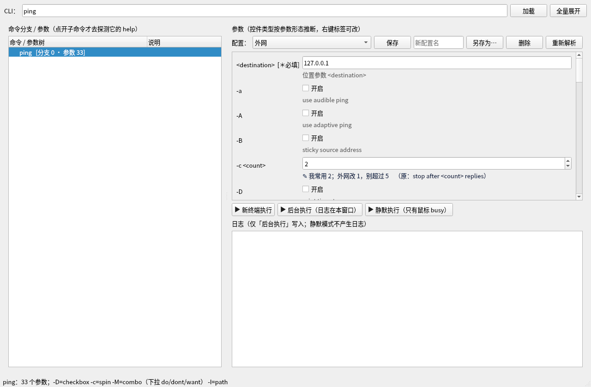
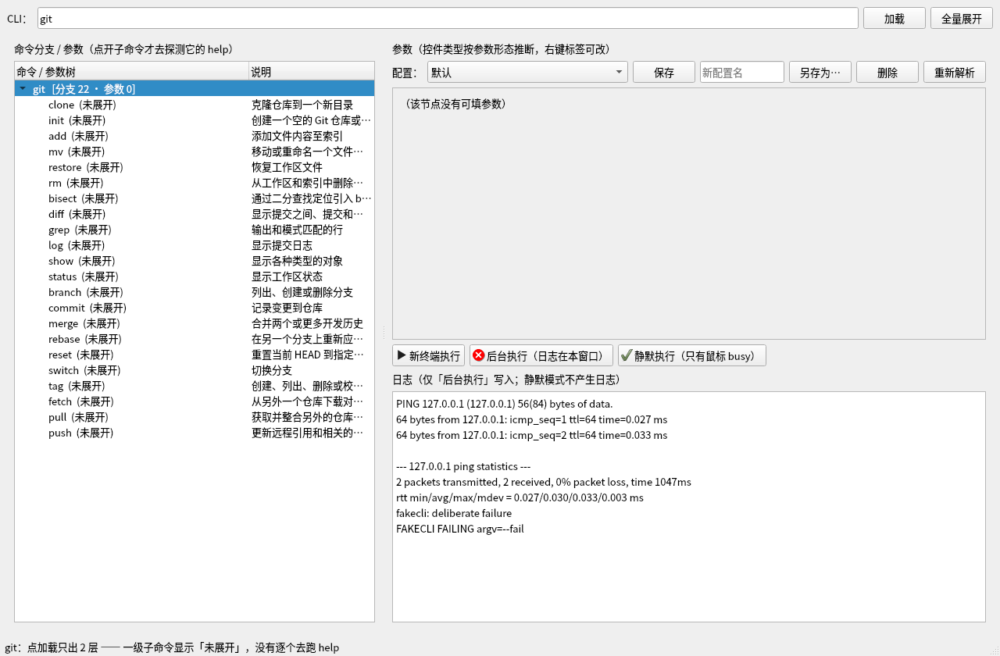
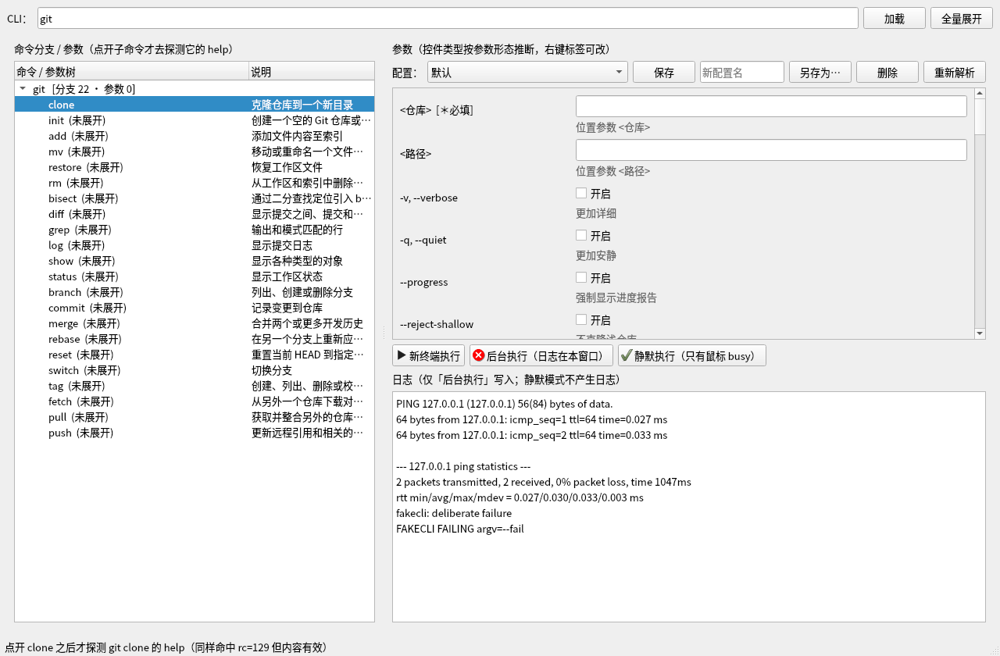
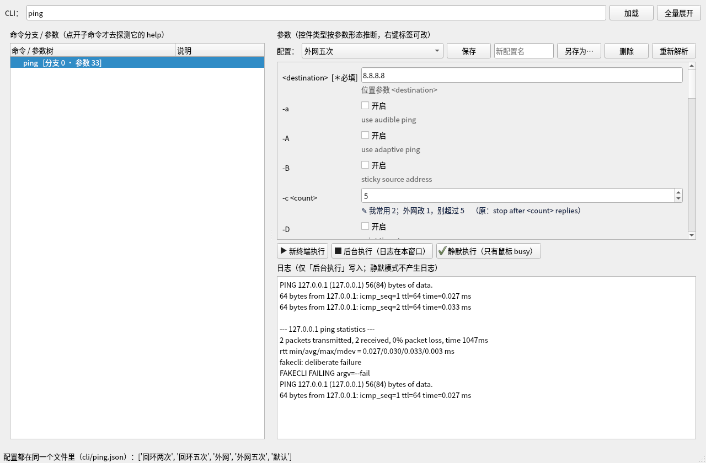
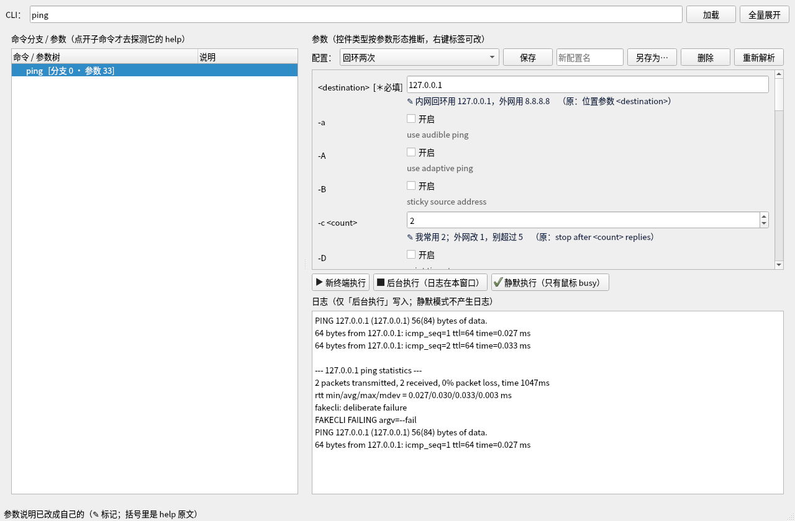
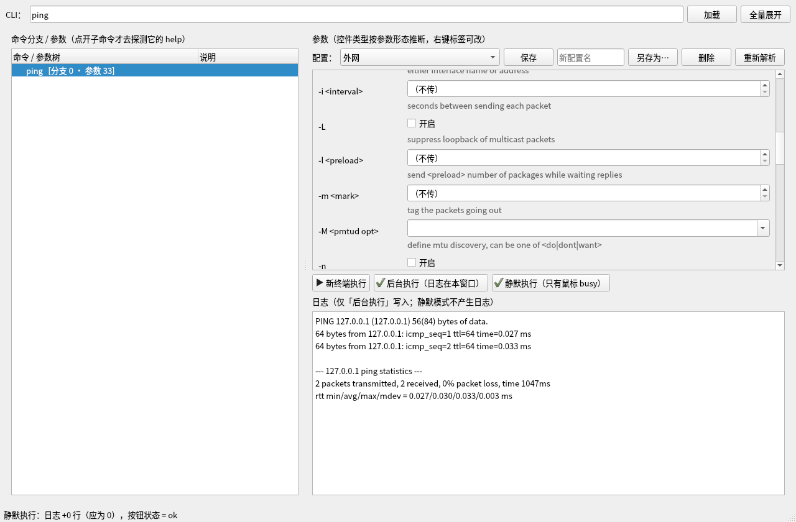
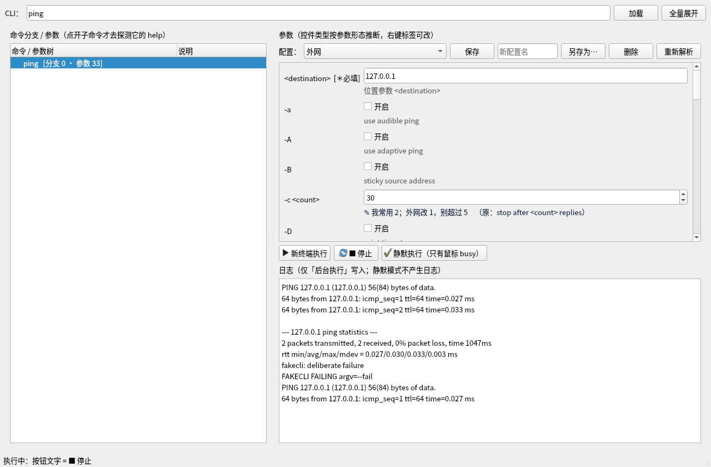
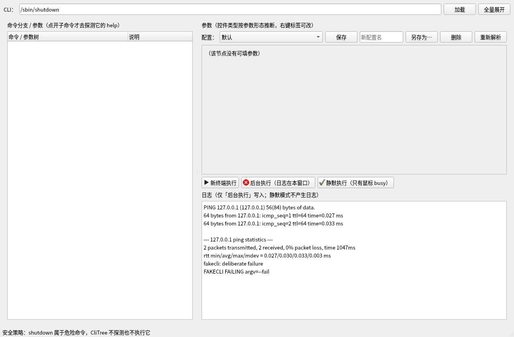

# CliTree — convierte herramientas de línea de comandos en un árbol de argumentos seleccionable

[English](README.md) | [中文](README.zh-CN.md) | **Español**

> Arrastra un ejecutable (o escribe un comando) → pulsa «Cargar» → a la izquierda aparece el árbol de argumentos,
> a la derecha los controles según la forma de cada argumento y abajo tres botones que ejecutan en
> «terminal nueva / segundo plano / silencioso». Sin memorizar `--help` y sin escribir en la línea de comandos.

Multiplataforma (Windows / Linux / macOS), Python puro ＋ PyQt5, dependencias solo el Python del sistema y Qt.



## Qué problema resuelve

El uso de las herramientas de línea de comandos está escondido en `help`: los nombres de los argumentos solo
en abreviatura, la descripción en una línea, cuál es obligatorio hay que deducirlo de la línea usage y los
valores de enumeración dispersos en el texto. CliTree **analiza todo esto a datos estructurados** y lo
renderiza en una interfaz operable:

- **Árbol de argumentos**: los argumentos de este comando ＋ los subcomandos de primer nivel; **solo al abrir
  un subcomando se ejecuta su help**, no se analiza todo de una vez;
- **Controles según la forma**: los argumentos sin valor reciben **casilla de verificación**, los de valor fijo
  una **lista desplegable editable**, los numéricos un campo numérico, las rutas un «Examinar…» y los
  repetibles una lista multivalor; cada argumento muestra **nombre completo ＋ abreviatura ＋ marcador de valor**
  y la **descripción original del help**;
- **La nota se puede cambiar por la tuya**: haz doble clic en la línea de la nota para reescribirla, se guarda
  en el archivo de configuración y sigue ahí la próxima vez;
- **Tres formas de ejecución**: abrir una terminal real / ejecutar en segundo plano mostrando la salida en esta
  ventana / ejecutar en silencio (solo gira el cursor, no escribe registro); durante la ejecución el botón pasa
  a «■ Detener» y un segundo clic termina el proceso; el icono de cada botón recuerda su último resultado;
- **Configuración reutilizable**: un archivo de configuración por herramienta, dentro puede haber **varios
  perfiles** (valores de argumentos para distintas máquinas y escenarios) y también se cachea el resultado del
  análisis — **la próxima vez que cargues la misma herramienta no hace falta volver a ejecutar help**.

## Inicio rápido

```bash
git clone <你的仓库地址> clitree && cd clitree

# 只依赖系统 Python（>=3.9）与 PyQt5
python3 -c "import PyQt5" || python3 -m pip install --user PyQt5

python3 -m clitree                # 打开界面
python3 -m clitree git            # 打开界面并直接加载 git
```

En una máquina sin cabecera (sin `DISPLAY`) se puede abrir la ventana con
`xvfb-run -a python3 -m clitree`; si no quieres abrir ventana, usa directamente el modo de análisis (ver abajo).

## Vista rápida de la interfaz

| Tras cargar solo hay 2 niveles | Solo al abrir un subcomando se sondea | Varios perfiles en una máquina | La nota se puede cambiar por la tuya |
|---|---|---|---|
|  |  |  |  |

| La salida del segundo plano entra en esta ventana | La ejecución silenciosa no escribe ni una línea | Se puede detener durante la ejecución | Los comandos peligrosos se bloquean |
|---|---|---|---|
|  |  |  |  |

Las 14 capturas están en [`screenshots/`](screenshots) y se pueden regenerar con
`xvfb-run -a python3 tools/make_screenshots.py`.

## Uso desde la línea de comandos

Además de la interfaz, CliTree también sirve como analizador (útil para scripts y para depurar reglas):

```bash
python3 -m clitree --parse ping                 # 真去探测 ping 并打印解析结果
python3 -m clitree --parse --help-file help.txt # 直接解析一个 help 文本文件
python3 -m clitree --tree git                   # 连树一起打印（根已解析、子命令待展开）
python3 -m clitree --check-rules                # 校验规则文件（坏 JSON / 坏正则会报出来）
python3 -m clitree --dump-rules                 # 打印生效规则（默认规则 ＋ 你的覆盖）
```

## Cuatro conceptos centrales

1. **El análisis es un «modelo de bloques», no una expresión regular línea a línea.** El nombre del argumento y
   su descripción suelen estar en dos líneas (`pnpm -v, --version` y la descripción en la línea siguiente) y en
   la línea de continuación puede volver a aparecer una palabra como `--delete` (tar) — CliTree une por
   «bloques», así la continuación no se convierte en un argumento nuevo.
   Detalles en [Reglas de análisis](docs/parsing-rules.es.md).
   Todo el comportamiento del análisis está en `clitree/rules/default.rules.json` (cada regla
   lleva su medición), tus ajustes van a `~/.config/clitree/rules.user.json` y
   `python3 -m clitree --check-rules` los valida.

2. **Criterio de obligatoriedad**: si existe la línea usage, **los argumentos se consideran siempre opcionales**
   (también funcionan sin pasarlos) y solo los **argumentos posicionales** se dividen en obligatorio/opcional;
   solo cuando ni siquiera hay usage se muestra «？sin determinar». Los obligatorios y los posicionales se
   colocan al principio del formulario.
3. **La configuración es un archivo**: `cli/<工具名>.json` guarda en un solo archivo la **caché del resultado del
   análisis** ＋ **varios perfiles** ＋ **tus propias notas de argumentos**. La próxima vez que cargues la misma
   herramienta se usa directamente la caché, sin ejecutar help. Ver [Configuración](docs/configuration.es.md).
4. **La ejecución solo usa argv**: los argumentos se entregan al proceso hijo como lista, **nunca se compone una
   cadena de shell**; el cuadro «otra entrada» al final del formulario se divide por espacios y se añade al
   final del comando; solo al abrir una terminal nueva se aplica el escape de comillas de la plataforma.
   Ver [Modos de ejecución](docs/execution-modes.es.md).

## Seguridad

- **Los comandos peligrosos nunca se sondean ni se ejecutan**: `shutdown` / `reboot` / `mkfs*` / `dd` / `fdisk` /
  `passwd` y otros 24 en total; en cualquier entrada (arrastrar, escribir, caché, ejecutar) se bloquean
  indicando el motivo;
- **`-h` solo se ejecuta si el texto de `--help` lo declara** (porque `sort -h`, `df -h` no son help);
- Todo sondeo: stdin cerrado ＋ `PAGER/MANPAGER/GIT_PAGER/SYSTEMD_PAGER=cat` (evita que se quede paginando) ＋
  tiempo de espera de 5 segundos por canal ＋ límite de salida de 256 KB;
- Al ejecutar en una terminal nueva se usa `shlex.quote` (POSIX) o las reglas de comillas de Windows.

## Documentación

La documentación, igual que el README, tiene **tres idiomas: inglés / chino / español**; el índice está en
[Índice de documentación](docs/index.es.md).

| Si quieres saber | Mira |
|---|---|
| Arquitectura, responsabilidades de los módulos, flujo de datos | [architecture](docs/architecture.es.md) |
| Cómo se analiza el help, cómo se cambia el archivo de reglas | [parsing-rules](docs/parsing-rules.es.md) |
| El formato completo de `cli/<工具名>.json` | [configuration](docs/configuration.es.md) |
| Los tres modos de ejecución y la semántica de detener | [execution-modes](docs/execution-modes.es.md) |
| Participar en el desarrollo, ejecutar pruebas, generar capturas | [contributing](docs/contributing.es.md) |
| Dependencias entre módulos (generado automáticamente) | [DEPENDENCY-TREE](docs/DEPENDENCY-TREE.md) |

## Desarrollo

```bash
python3 -m pytest -q                              # 165 pruebas (160 pasan; 5 específicas de plataforma — ver Limitaciones conocidas)
python3 tools/deps_tree.py                        # 重新生成依赖关系树
xvfb-run -a python3 tools/make_screenshots.py     # 重新生成 14 张界面截图
```

Entornos medidos: Python 3.10.12 ＋ PyQt5 5.15.6 (Linux) y Python 3.14.6 ＋ PyQt5 5.15.11 (Windows); las pruebas se ejecutan con
`QT_QPA_PLATFORM=offscreen`. Las convenciones de desarrollo y «lo que no está verificado» están en
[contributing](docs/contributing.es.md).

## Verificación medida

| Elemento | Lectura |
|---|---|
| Pruebas | `python3 -m pytest -q` ⇒ **160 passed** (29 fixtures de help reales, inferencia de controles, seguridad del sondeo, carga diferida, ejecutor, archivos de configuración, smoke de GUI; las otras 5 son específicas de plataforma — ver [limitaciones conocidas](#limitaciones-conocidas-enumeradas-con-honestidad)) |
| Análisis de CLI reales | `ping` 33 parámetros (`-c` numérico, `-M` lista `do/dont/want`, `-I` ruta, `-D` casilla)｜`git` 22 subcomandos｜`tar` 166 parámetros｜`curl --help all` 244 parámetros｜`gdb` por su canal interactivo: **111 781 B** (su `--help` solo tiene 3 071 B) |
| Windows, medido en local (2026-10) | Windows 11 ＋ Python 3.14.6 ＋ PyQt5 5.15.11: `ping` se analiza en 18 parámetros (posicional de palabra simple `target_name` obligatorio, `-4`/`-6` numéricos, `-n` como campo numérico); `ping -n 2 127.0.0.1` se ejecuta de extremo a extremo ⇒ rc=0, se reciben respuestas; la ayuda en inglés y en chino (zh-CN) está cubierta por fixtures |
| Carga diferida | `--tree git` ⇒ raíz analizada y los 22 subcomandos en `pending`; expandir el mismo nodo dos veces añade **0** sondeos |
| Caché y perfiles | Una segunda ventana que carga `ping` realiza **0 sondeos** (directo desde la caché); el cambio de perfil, «guardar como» y los dos niveles de notas están en [configuración](docs/configuration.es.md) |
| Tres modos | En segundo plano `ping -c 2 127.0.0.1` ⇒ **+6 líneas de log**, botón `ok`; ejecución silenciosa del mismo comando ⇒ **+0 líneas**, botón `ok`; volver a pulsar durante `ping -c 30` ⇒ estado `stopped` |
| Seguridad | Los 24 comandos peligrosos se rechazan en todos los puntos de entrada (cargar `/sbin/shutdown` deja el árbol y el formulario vacíos y explica el motivo en la barra de estado) |
| Autocomprobación de reglas | `python3 -m clitree --check-rules` ⇒ `RULES-CHECK=PASS` (12/12 expresiones regulares compilan en Python) |
| Capturas | `xvfb-run -a python3 tools/make_screenshots.py` ⇒ **14 imágenes** (se usaron offscreen y renderizado X real) |

Entorno: Ubuntu 22.04, Python 3.10.12, PyQt5 5.15.6 (parte Linux), más Windows 11, Python 3.14.6, PyQt5 5.15.11 (parte Windows). **Ninguna fila de esta tabla es una estimación**; lo que no se midió aparece en [limitaciones conocidas](#limitaciones-conocidas-enumeradas-con-honestidad) y en [contribuir](docs/contributing.es.md).

## Limitaciones conocidas (enumeradas con honestidad)

- **Windows solo está parcialmente verificado (2026-10), macOS nada**: el análisis y la ejecución de `ping`
  y la suite local se han probado en Windows 11 (ver la tabla anterior); el canal `-?`, abrir terminal con
  `cmd start` y el empaquetado siguen solo como código;
- **Casi ningún valor de enumeración se puede extraer**: de 105 comandos reales, solo `ping` escribe
  explícitamente el conjunto de valores en su help, en dos sitios ⇒ la lista desplegable es siempre editable y,
  si no se extrae, no se inventan candidatos;
- **La extracción del bloque de subcomandos no es fiable**: los 91 de `pnpm` son reales y el bloque de nombres de
  columna de `lsblk` hay que descartarlo con una condición de respaldo, por eso al cargar solo salen 2 niveles y
  el sondeo ocurre al expandir;
- **El modo de terminal nueva no obtiene el código de retorno del proceso hijo**: por eso solo muestra
  «iniciado en la terminal», no determina éxito o fallo y tampoco se puede detener.

## Licencia

[MIT](LICENSE).
